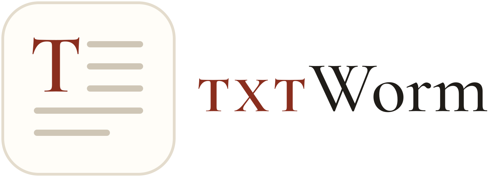
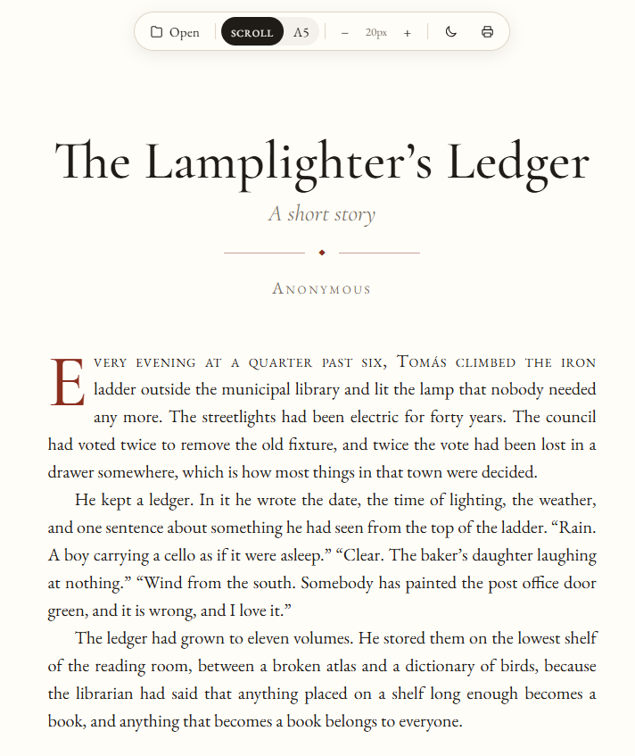
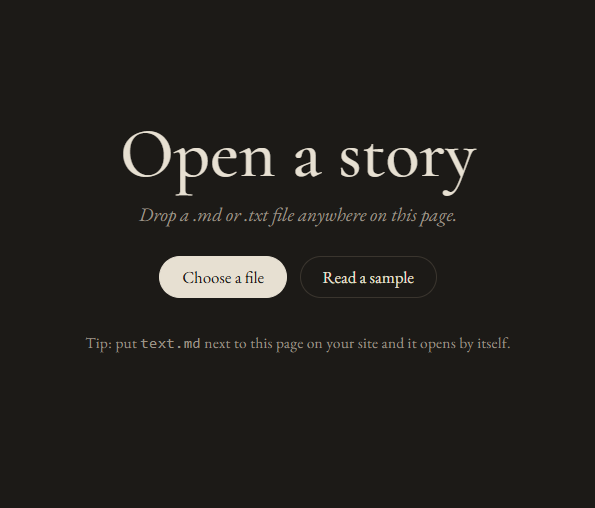
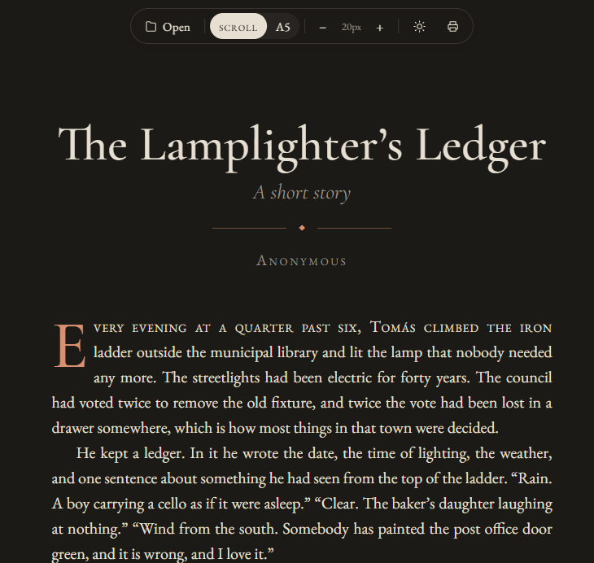

<p align="center">
  <picture>
    <source media="(prefers-color-scheme: dark)" srcset="logo/txtworm-lockup-dark.svg">
    
  </picture>
</p>

<p align="center"><em>Pronounced “text worm”. A bookworm for plain text.</em></p>

<p align="center">
  <a href="https://jeronimovis.github.io/txtworm/"><strong>Try it live →</strong></a>
</p>

---

**TXTworm** is a single HTML page that turns any `.txt` or `.md` file into a beautiful, book-like page to read. You get serif type, a drop cap, justified text in a calm central column, A5 pages if you want them, and a dark mode for reading at night.

No install, no build, no account. Open the page and drop a story on it.



## Why I made it

I read a lot of short stories, and many of them reach me as plain text files. Reading them as they are isn't much fun, so I was always trying to make them look nice. I'd paste them into Google Docs and change the fonts, or export them as EPUB and open them in an e-reader app on my phone.

TXTworm skips all of that. Give it any plain text or Markdown file and it shows the story the way a good book would, so the only thing left to do is enjoy reading it.

## Features

- **Book typography:** EB Garamond for the text and Cormorant Garamond for the titles. Justified, hyphenated paragraphs with first-line indents, like a printed page.
- **A proper title page:** a large title with a subtitle, an ornament and the author's name.
- **A drop cap** on the first paragraph, with the rest of the first line in small caps.
- **Two layouts:**
  - **Scroll:** continuous text in a central column.
  - **A5:** real numbered A5 pages, with a running header and wider inner margins on alternate pages. Print them, or save them as a PDF.
- **Light and dark modes.** It follows your system setting until you choose one.
- **Text size** with the **−** and **+** buttons. You keep your place when you change it.
- **Smart punctuation:** "straight quotes" become “curly quotes”, `--` becomes an em dash (—) and `...` becomes an ellipsis (…).
- **English and Spanish:** it detects the story's language and hyphenates accordingly.
- **Remembers you:** your last story, layout, size and theme are still there next time.

<table>
  <tr>
    <td></td>
    <td></td>
  </tr>
</table>

## How to use it

### Online
Open the [live page](https://jeronimovis.github.io/txtworm/), then drag a `.txt` or `.md` file onto it, or click **Choose a file**. Your file stays in your browser and is never uploaded anywhere.

### On your computer
Download `index.html`, open it in any modern browser, and drop a file on it.

### On your own website
Put `index.html` in a folder and add your story as `text.md` (or `text.txt`) next to it. The page opens the story by itself.

To show a different file from the same folder, add `?file=` to the address:

```
https://example.com/stories/index.html?file=the-lamplighter.md
```

## Writing your files

### Plain text (.txt)
- Every line is a paragraph.
- The first line becomes the title if it's short and doesn't end in a full stop.
- A line with `***` or `---` becomes a scene break (⁂).
- Hard-wrapped files, such as Project Gutenberg books (lines cut at a fixed width, with blank lines between paragraphs), are detected and joined back into full paragraphs.

### Markdown (.md)
You can set the title, subtitle and author at the top of the file:

```markdown
---
title: The Lamplighter's Ledger
subtitle: A short story
author: Anonymous
---

Every evening at a quarter past six, Tomás climbed the iron ladder…
```

Or simply start with a heading. A line in italics right after it becomes the subtitle, and a line starting with “By …” (or “Por …”) becomes the author:

```markdown
# The Lamplighter's Ledger
*A short story*
By Anonymous

Every evening at a quarter past six…
```

If there's no title at all, TXTworm uses the file name.

Markdown also gives you `## headings` for parts or chapters, *italics*, **bold**, > quotes, lists, links and images. A line with `---` becomes a scene break.

## Keyboard shortcuts

| Key | Action |
|-----|--------|
| <kbd>+</kbd> / <kbd>−</kbd> | Larger / smaller text |
| <kbd>P</kbd> | Switch between Scroll and A5 |
| <kbd>D</kbd> | Light / dark mode |
| <kbd>O</kbd> | Open a file |

## Printing and PDFs

Switch to **A5** and click the printer icon. Choose “Save as PDF” to get a little book you can read anywhere. The pages print in light mode, without shadows or buttons.

## Good to know

- Everything is in one file: `index.html`. There's nothing to install and no build step.
- The fonts come from Google Fonts, so the page needs an internet connection to look its best. Offline, it falls back to Garamond, Palatino or Georgia.
- Opening `text.md` automatically only works when the page is served from a website, such as GitHub Pages. From your own disk, drag the file onto the page instead.

## License

[MIT](LICENSE). Use it, change it and share it. Just keep the credit.
