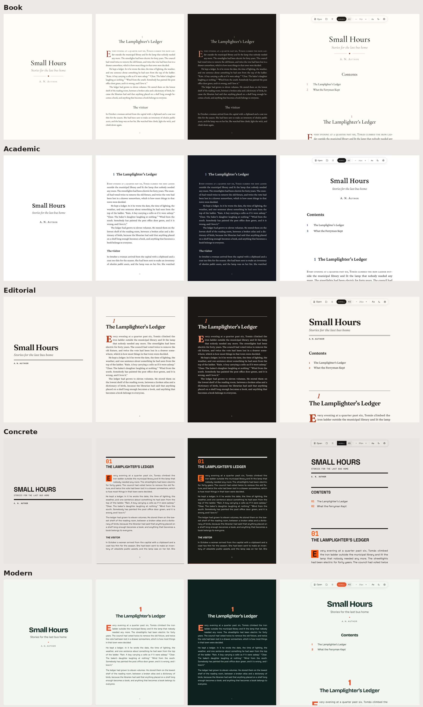

<p align="center">
  <picture>
    <source media="(prefers-color-scheme: dark)" srcset="logo/txtworm-lockup-dark.svg">
    
  </picture>
</p>

<p align="center"><em>Pronounced “text worm”. A bookworm for plain text.</em></p>

<p align="center">
  <a href="https://jeronimovis.github.io/txtworm/story/"><strong>See a story →</strong></a>
  &nbsp;·&nbsp;
  <a href="https://jeronimovis.github.io/txtworm/antology/"><strong>See an anthology →</strong></a>
  &nbsp;·&nbsp;
  <a href="https://jeronimovis.github.io/txtworm/"><strong>Open your own file →</strong></a>
</p>

---

**TXTworm** is a single HTML page that turns plain `.txt` and `.md` files into beautiful, book-like reading. Put it next to one story and it shows that story. Put it next to a list of stories or chapters and it becomes a book, with a cover, a title page, a table of contents and numbered pages.

No install, build, or account. Any aspiring writer can drop their text in a folder, put it online, and send people a link.


## Why I made it

I read a lot of short stories, and many of them reach me as plain text files. Reading them as they are isn't much fun, so I was always trying to make them look nice. I'd paste them into Google Docs and change the fonts, or export them as EPUB and open them in an e-reader app on my phone.

TXTworm skips all of that. Give it any plain text or Markdown file and it shows it the way a good book would, so the only thing left to do is enjoy reading.

## Features

- **A single story or a whole book:** one `text.md` gives you a story; a `content.md` plus numbered files or folders gives you an anthology or a novel.
- **Two layouts:**
  - **Scroll:** continuous text in a calm central column.
  - **A5:** renders numbered A5 pages, ready to print or save as a PDF.
- **Five styles:** Book, Academic, Editorial, Concrete and Modern, each in light and dark.
- **Book typography:** justified, hyphenated paragraphs; a drop cap on each story's first paragraph; curly quotes, em dashes and ellipses.
- **Covers and pictures:** a cover for the book, a cover for each chapter, and pictures anywhere in the text. Pictures shaped like an A5 page fill a whole page.
- **English and Spanish:** hyphenation follows the language of the text, and the contents page is titled “Contents” or “Índice”.
- **Text size** with **−** and **+**, and it remembers your layout, size, style and theme.

## Quick start

### A single story
Put `index.html` and your story, named `text.md` (or `text.txt`), in a folder:

```
story/
├── index.html
└── text.md
```

Upload the folder to your website or GitHub Pages and open its address. That's it. → [See it in action](https://jeronimovis.github.io/txtworm/story/)

### A book (anthology or novel)
Add a contents file, `content.md` (or `content.txt`), and one numbered file per story or chapter:

```
antology/
├── index.html
├── content.txt
├── cover.jpg        (optional)
├── 01.md
├── 02.md
└── 03.txt
```

→ [See it in action](https://jeronimovis.github.io/txtworm/antology/)

The contents file has the book's title on the first line, then an optional subtitle and author, then the list:

```
Stories of the River
A small anthology
By Jerónimo Visñovezky

1. The boy who lived
2. A trip to school
3. Understanding Steven
```

The list can be numbered `1.`, `1)`, `01.`, lettered `A.`, in Roman numerals `IV.`, or bulleted with `-`.

## Building a book

### Naming the chapters
Chapters can be numbered files or numbered folders. Use whichever naming you like:

| Naming | Files | Folders |
|---|---|---|
| Numbers | `1.md` `2.md` `3.md` | `1/text.md` `2/text.md` |
| Zero-padded | `01.md` `02.md` `03.md` | `01/text.md` `02/text.md` |
| Letters | `a.md` `b.md` or `A.md` `B.md` | `a/text.md` `A/text.md` |

Each chapter can be `.md` or `.txt`, and you can mix them.

Folders are handy when chapters have their own pictures:

```
novel/
├── index.html
├── content.md
├── cover.png
├── 1/
│   ├── text.md
│   └── cover.jpg      ← shown before chapter 1
├── 2/
│   ├── text.md
│   └── storm.png      ← used inside chapter 2
└── 3/
    └── text.md
```

### Chapter titles
- With a contents file, chapter titles come from its list. If a chapter file also starts with the same title, it isn't repeated.
- Without one, put a `title.md` (or `title.txt`) in the folder with the book's title, subtitle and author. Each chapter's title then comes from the first line of its file.
- If a chapter in the list has no file, the contents shows it as “(missing)”. Hover over it to see which file names were tried.

### Covers
- `cover.png`, `cover.jpg`, `cover.jpeg` or `cover.webp` next to `index.html` is shown first, as wide as the text. This also works for a single story.
- The same file name inside a chapter folder is shown before that chapter.

### Pictures inside the text
Put a tag on a line of its own, wherever you want the picture:

```
[map.png]
[map.png "The road to school"]
[img map.png "The road to school"]

```

Text in quotes becomes the caption. Pictures are looked for in the chapter's folder first, then next to `index.html`. If one can't be found, the page says “Image not found: map.png” instead of showing a broken image.

### Full-page pictures
In the A5 layout, any picture shaped like an A5 page (148 × 210 mm, about 5:7) fills the whole page, edge to edge, with no margins or page number. A book cover becomes a full cover. A chapter cover becomes the chapter's opening page. A picture in the middle of a story goes on the next page, after the current one fills with text.

## Writing your files

- **One paragraph per line.** Write the way you normally do: each line is a paragraph, and blank lines between them are optional. Dialogue lines starting with “—” each get their own line.
- **Hard-wrapped text** (lines cut at a fixed width, like Project Gutenberg books) is detected and joined back into full paragraphs.
- **Title, subtitle and author:** start a story with a heading, an optional line in italics and a “By …” or “Por …” line:

  ```markdown
  # Pendular
  *A short story*
  Por Jerónimo Visñovezky
  ```

  Or use a header block:

  ```markdown
  ---
  title: Pendular
  subtitle: A short story
  author: Jerónimo Visñovezky
  style: editorial
  ---
  ```

- **Sections:** `## ELLA` makes a heading inside the story.
- **Scene breaks:** a line with `---` or `***`.
- **Emphasis:** `*italics*` and `**bold**`. Quotes, `>`, lists and links also work in `.md` files.
- In a `.txt` file, the first line is the title if it's short and doesn't end in a full stop.

## Layouts

### Scroll
Continuous text in a central column. In a book, the contents links jump to each chapter, and the list button in the toolbar takes you back to the contents.

### A5
Real A5 pages, laid out like a printed book:

- The front pages (cover, title page and contents) have no numbers.
- Page 1 is the first page of the first story or chapter, always on a right-hand page.
- Each chapter starts on a new page.
- Running heads show the book title on left-hand pages and the chapter title on right-hand pages.
- The contents lists the page number of each chapter.
- Paragraphs flow across pages without leaving a lonely first line at the bottom.

Click the printer icon and choose “Save as PDF” to get a little book you can read anywhere.

## Styles



| Style | Look |
|---|---|
| **Book** | A classic printed book. EB Garamond and Cormorant, warm paper, a red drop cap. |
| **Academic** | A scholarly edition. Crimson Pro, white paper, navy accents, numbered left-aligned chapter headings, the first line in small capitals and a ∎ at the end. |
| **Editorial** | A magazine feature. Big Fraunces headlines, Source Serif text, small Libre Franklin labels, a double rule under the title and a ■ end mark. |
| **Concrete** | Brutalist. Space Grotesk in capitals, orange monospaced chapter numbers (“01”), heavy black rules and a drop cap in a solid orange square. |
| **Modern** | Sans serif. Bricolage Grotesque and Figtree, deep green ink on pale sage with coral accents, with spaced paragraphs. |

Choose a style from the **Aa** button. A story or book can set its own default with `style: modern` (or another name) in its header block, in `text.md`, `content.md` or `title.md`. A reader who picks another style from the menu gets theirs instead.

### Adding a style
All the looks are kept apart from how the page works, so a new style never breaks anything. In `index.html`:

1. Copy one of the style blocks in the second `<style>` section and give it a new name. Change its fonts, colours, sizes, ornaments or page margins.
2. Add the name to `STYLES` at the top of the script, with its label and Google Fonts link.

It then appears in the Aa menu. Comments in the file explain each setting.

## Reading on your own computer

Open `index.html` in any modern browser, then:

- **A story:** click **Choose a file**, or drag a `.txt` or `.md` file onto the page.
- **A book:** click **Open a folder** (the folder button) and choose the book's folder, or drag the whole folder onto the page.

Browsers don't let a page read the other files in its folder by itself, so on your computer you open them by hand. Online, the page finds everything on its own. Your files stay in your browser and are never uploaded anywhere.

To open a different story in the same online folder, add `?file=` to the address:

```
https://example.com/stories/index.html?file=the-lamplighter.md
```

## Keyboard shortcuts

| Key | Action |
|-----|--------|
| <kbd>+</kbd> / <kbd>−</kbd> | Larger / smaller text |
| <kbd>P</kbd> | Switch between Scroll and A5 |
| <kbd>D</kbd> | Light / dark mode |
| <kbd>S</kbd> | Next style |
| <kbd>C</kbd> | Go to the contents (books) |
| <kbd>O</kbd> | Open a file |

## Good to know

- Everything is in one file, `index.html`. There's nothing to install and no build step.
- Fonts come from Google Fonts, so the page needs an internet connection to look its best. Offline, it falls back to fonts already on your computer.
- If a folder has both a `text.md` and a `content.md`, the book wins.

## Logo

The logo files are in [`logo/`](logo/): the icon, the wordmark, the full logo and a favicon, each in light and dark. All are SVGs with the letters turned into shapes, so they display correctly without any fonts installed.

## License

[MIT](LICENSE). Use it, change it and share it. Just keep the credit.
